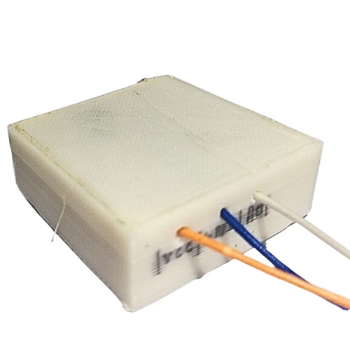
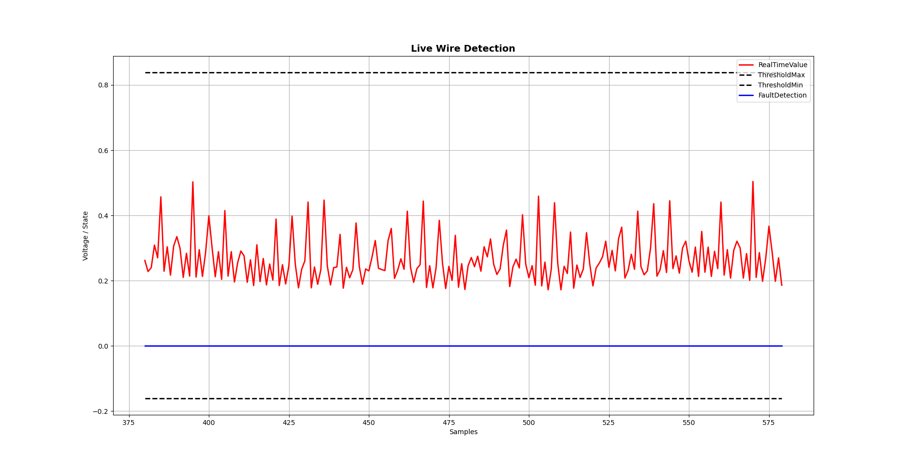
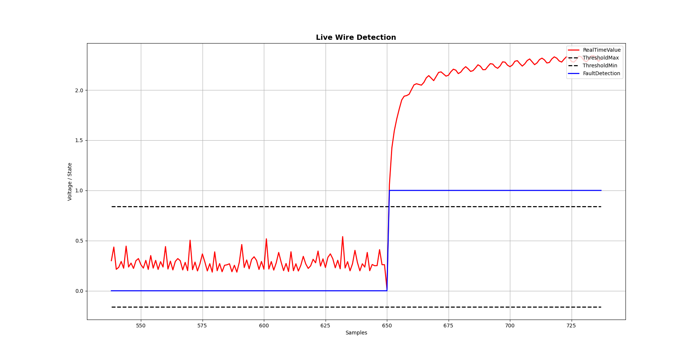
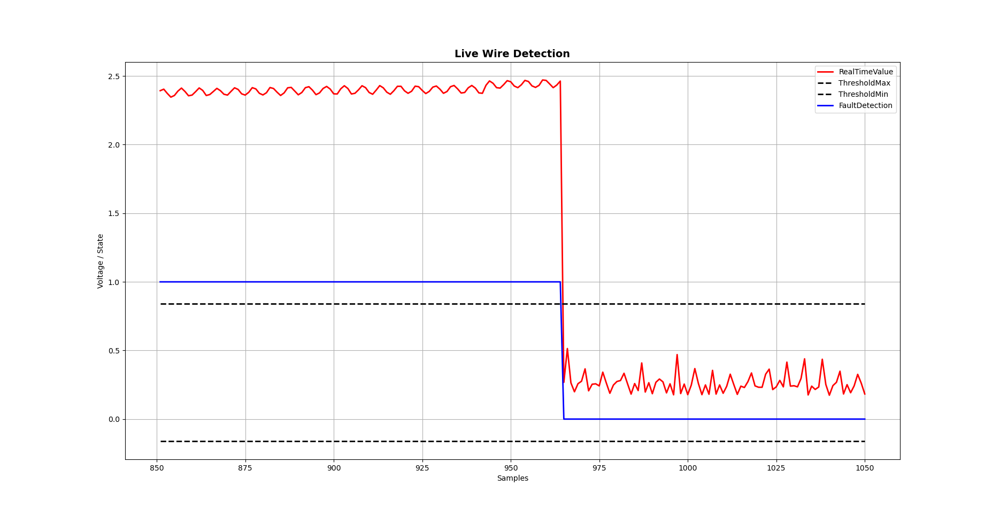

<div align="center">

<!-- Swap this for the background-removed Jatayu sensor image once added: assets/images/jatayu_sensor.png -->


# ⚡ Angad System
### Sentient Power Grid Guardian — Real-Time IoT Fault Detection Network

*A custom electromagnetic-field–based sensor network that detects Low Voltage AC overhead conductor breakage in real time and dispatches field technicians automatically.*

[](#-sih-2025-submission)
[](#)
[](#)
[](#)
[](#)
[](#-license)

[**Watch the Full Demo Video**](#-demo) · [Architecture](#-architecture) · [Getting Started](#-getting-started) · [Project Structure](#-project-structure)

</div>

---

## 🏆 SIH 2025 Submission

**Built by Team AIR Revolutionaries** for Smart India Hackathon 2025.

| Field | Detail |
|---|---|
| **Problem Statement ID** | SIH25063 |
| **Problem Statement Title** | Developing a cost-effective solution for detecting the breakage of Low Voltage AC Distribution Overhead conductors |
| **Theme** | Disaster Management |
| **PS Category** | Hardware |
| **Team ID** | 79864 |
| **Team Name** | AIR Revolutionaries |

---

## 📌 Overview

**Angad** is a distributed fault-detection network for Low Voltage AC overhead power lines. A mesh of low-cost IoT nodes — each fitted with **Jatayu**, a custom-built, non-intrusive electromagnetic-field sensor — continuously monitors conductors for breakage, sparking, and abnormal current flow. The moment a fault is detected, the alert travels across the network's own communication protocol (**Ram Setu**) to a backend server, which identifies the nearest available lineman via **JAMWANT**, the team's purpose-built mobile app, and shares the exact fault location on a map.

**Why it matters:** overhead conductor faults are a leading cause of preventable electrocution deaths in India, and existing detection hardware (Fault Passage Indicators, Smart-Grid IoT nodes) costs ₹20,000–₹50,000+ per unit — too expensive to deploy at scale. Angad's sensor costs **₹500–₹800**, making dense, life-saving coverage financially realistic for utilities and rural electrification projects alike.

---

## 🎥 Demo

A complete walkthrough — hardware, sensor validation, and live fault-to-resolution flow — is available here:

📽️ **[Full Video Presentation (Google Drive)](#)** <!-- Replace # with your Drive share link -->
🎬 **[Prototype Functioning Demo](#)** <!-- Replace # with the "Video Presentations" link from the SIH deck -->

> Set sharing to "Anyone with the link can view" before sharing externally.

---

## 📊 Jatayu Sensor — Live Detection Graphs

Captured directly from the Jatayu sensor, showing the electromagnetic field and current-flow signature across the three key monitoring states.

<table>
<tr>
<td width="33%" align="center">

**🟢 Normal Condition**



Stable EM field detected; current flow within expected range.

</td>
<td width="33%" align="center">

**🔴 Fault Detected**



Significant EM field disruption and current-flow anomaly detected.

</td>
<td width="33%" align="center">

**✅ Fault Resolved**



EM field stability restored; normal current flow resumed.

</td>
</tr>
</table>

> **Note:** `normal_condition_Jatayu.png` and the background-removed sensor image weren't part of this upload — drop them into `assets/images/` using the exact filenames above and the table/header will render automatically.

---

## 🏗️ Architecture

### System Layers

```
┌───────────────────┐   Ram Setu Protocol   ┌───────────────────┐    REST / WebSocket    ┌───────────────────┐
│  Jatayu Sensor Node │ ────────────────────▶ │   Flask Backend    │ ─────────────────────▶ │  JAMWANT App /     │
│ (ATMega328 + nRF24) │ ◀──────────────────── │  (API + Socket.IO) │ ◀───────────────────── │  Web Dashboard     │
└───────────────────┘  (nRF24L01 + GSM)      └───────────────────┘     Live Updates        └───────────────────┘
```

### How the Sensor Works

A current-carrying conductor generates an electromagnetic field proportional to load. Jatayu exploits this:

1. **Detect** — a coil-like antenna senses the EM field around the live wire
2. **Filter** — DC components are stripped from the raw signal
3. **Amplify** — the filtered AC signal is amplified and passed to the controller's output pin
4. **Sample** — an ATMega328P reads the signal via its 0–5V ADC
5. **Compare** — readings from sensors at both ends of a conductor span are compared; an abnormal difference between them indicates power loss (a fault) and triggers an alert

### Communication Protocol — "Ram Setu"

A hybrid **star + bus** topology carries alerts from sensor to server with guaranteed delivery and continuous health checks:

- **Node naming convention:** Head (master) devices are named **Nal**, sensor (slave) devices are named **Neel** — e.g. `Head(Nal01)`, `Node(Neel01)`, `Node(Neel02)`
- **Alert flow:** `Node → Head → Server`, each hop acknowledged (ACK) so a fault signal is never silently lost
- **Heartbeat monitoring:** every device periodically confirms it's alive; heads monitor their nodes, and the server monitors the heads — a multi-level check that isolates failures instead of collapsing the whole chain
- **Hybrid backhaul:** local mesh over nRF24L01, escalating to GSM where needed

### Data Flow — Detection to Resolution

| Step | Actor | Action |
|------|-------|--------|
| 1 | Jatayu Sensor | Reads EM field / power consumption, samples via ATMega328P ADC |
| 2 | Sensor Node | Detects fault from sensor data, sends alert to Head device via Ram Setu |
| 3 | Head Node | Forwards alert to the server |
| 4 | Backend | Retrieves fault location from device database |
| 5 | AI Model | Assesses fault severity using weather data + past detection history |
| 6 | Backend | Selects the appropriate lineman and notifies via JAMWANT, with Google Maps location link |
| 7 | Lineman | Accepts, resolves, and updates status in real time via JAMWANT |

<details>
<summary><strong>WebSocket Event Reference</strong></summary>

```
Socket.IO Namespace: /
├── new_fault        → {fault_id, device_id, severity, location}
├── fault_update      → {fault_id, status, assigned_to, updated_at}
├── lineman_update    → {lineman_id, status, assignments_count}
└── alert_broadcast   → {message, priority, action_required}
```
</details>

### JAMWANT — The Field App

A purpose-built mobile app serving as the interface for both linemen and authorised officers:

- Notifies linemen of new faults with risk level and Google Maps link to the exact location
- Gives officers access to the live device/fault database and server status
- Same app, role-based views for field and command staff

---

## ✨ Features

- 🔎 **Real-time fault detection** via a custom, non-intrusive EM-field sensor (Jatayu)
- 📡 **Hybrid mesh + GSM communication** (Ram Setu protocol) with guaranteed, ACK'd delivery
- ⚡ **Fault detection and notification in fractions of a second**
- 🧠 **AI-assisted severity scoring** using weather data and historical fault patterns
- 🧑‍🔧 **JAMWANT app** — real-time lineman dispatch with map-linked fault location
- 🛡️ **Self-healing network** — multi-level heartbeat monitoring isolates failed nodes automatically
- 🌡️ **Self-calibration** — devices adapt their own thresholds to environmental conditions, no manual re-calibration
- 💰 **97.5% cheaper** than existing market alternatives, enabling dense deployment at scale

---

## 🧰 Tech Stack

| Layer | Technologies |
|---|---|
| **Sensor Hardware** | **Jatayu** — custom EM-field transducer, designed from scratch |
| **Microcontroller / Networking** | Arduino (ATMega328P), nRF24L01, GSM Module |
| **Communication Protocol** | Ram Setu (custom hybrid star + bus topology) |
| **Backend** | Python, Flask, Flask-SocketIO, SQLAlchemy, SQLite |
| **Frontend / Dashboard** | React 18, Tailwind CSS, React Router v6, Axios, Vite |
| **Mobile App** | JAMWANT — Android Studio |
| **Design & Prototyping** | Fritzing, AutoCAD, Blender |
| **Real-Time Layer** | Socket.IO (WebSocket) |

---

## 💰 Feasibility & Cost Comparison

| Solution | Cost | Reference |
|---|---|---|
| **Angad (our solution)** | **₹500–₹800** | — |
| Fault Passage Indicator (FPI) | ₹20,000–₹50,000 | [elektrolites.com](https://elektrolites.com/) |
| Smart-Grid IoT Node | ₹50,000+ | [se.com](https://www.se.com/ww/en/) |

**Technical feasibility:** custom low-cost EM-sensor validated against market alternatives; hybrid ATMega328P + nRF24L01 topology proven for both local and large-scale fault reporting; internet-independent real-time detection.

**Operational feasibility:** compact, non-intrusive install on live wires with zero modification to existing infrastructure; automated alerting removes manual inspection; no recurring calibration.

### Challenges & Mitigations

| Risk | Impact | Mitigation |
|---|---|---|
| Single point of failure (node/head outage) | Chain collapse, monitoring gap | Multi-level heartbeat monitoring — heads track nodes, server tracks heads; failures are isolated, not fatal |
| Environmental variation (resistance, conductivity, EM strength) | False detections, reduced accuracy | Self-calibration — each device learns its own baseline from surrounding conditions instead of using fixed thresholds |

---

## 🌍 Impact & Benefits

- **Safety-first:** overhead conductor faults and unnoticed live wires are a recurring cause of electrocution deaths across India for workers, the public, and animals; early, automated detection directly reduces that risk (see [Research & References](#-research--references))
- **Reliability:** real-time fault identification prevents small unnoticed faults from cascading into large-scale blackouts
- **Operational efficiency:** replaces slow, costly, and dangerous manual line inspection with automated alerting
- **Scalability:** hybrid bus + star topology suits everything from industrial plants to rural electrification projects
- **Economic:** ₹500–₹800 per sensor vs. ₹20k–₹50k+ alternatives makes wide-scale deployment financially viable
- **Environmental:** early fault detection reduces energy leakage and equipment damage, cutting e-waste and supporting smart-grid sustainability goals

---

## 📈 Performance

| Metric | Target | Current |
|---|---|---|
| Detection Latency | < 100 ms | ~50 ms |
| Transmission Delay | < 500 ms | ~200 ms |
| Backend Processing | < 100 ms | ~80 ms |
| UI Update Time | < 1000 ms | ~600 ms |
| **End-to-End Alert** | **< 2 s** | **~1.2 s** |
| Concurrent Devices | 1000+ | Tested with 50 |
| WebSocket Throughput | 1000 msgs/s | Tested at 500/s |

---

## 🚀 Getting Started

### Prerequisites

```bash
# Hardware
- NodeMCU v3 / Arduino boards (ATMega328P)
- nRF24L01 RF modules
- GSM module
- Jatayu EM-field sensor (custom build)

# Software
- Python 3.8+
- Node.js 16+
- Arduino IDE
- Android Studio (for JAMWANT app)
- Git
```

### 1. Clone the Repository

```bash
git clone https://github.com/your-org/AIR-Angad-System.git
cd AIR_Angad_System
```

### 2. Backend Setup (Flask)

```bash
cd Jatayu_web_interface/backend
source flask/bin/activate
pip install -r requirements.txt
python -c "from app import app, db; app.app_context().push(); db.create_all()"
python run.py
# → http://127.0.0.1:5000
```

### 3. Frontend Setup

```bash
cd ../frontend
npm install
npm start
# → http://localhost:3000
```

### 4. IoT Firmware

```bash
# Arduino IDE → Board: NodeMCU 1.0 (ESP-12E Module) / ATMega328P
# Port: /dev/ttyUSB0 (Linux) or COM3 (Windows)
# Sketch: Angad_test_codes/AIR0214_Angad_Last/AIR0214_Angad_Last.ino
# Upload
```

---

## 📁 Project Structure

```
AIR_Angad_System/
├── Angad_test_codes/                 # Hardware firmware & testing
│   ├── AIR0214_Angad_Head/           # Head (Nal) node coordination
│   ├── AIR0214_Angad_middle/         # Relay node
│   ├── AIR0214_Angad_Last/           # Sensor (Neel) node — Jatayu
│   └── em_sensor_test_NodeMCU/       # Jatayu sensor validation
├── Angad_Nal_NodeMCU_test_code/       # Region-specific firmware
└── Jatayu_web_interface/              # Main web application
    ├── backend/                       # Flask app
    │   ├── app.py / models.py / config.py
    │   └── requirements.txt
    └── frontend/                      # React app
        ├── src/pages/                 # OfficerDashboard, LinemanDashboard
        ├── src/components/
        └── src/services/               # api.js, socket.js
```

---

## 🔐 Security Roadmap

Current build prioritizes rapid deployment. Production hardening checklist:

- [ ] TLS/SSL for all transmissions
- [ ] JWT-based API authentication
- [ ] CORS origin whitelisting
- [ ] Rate limiting on fault submission
- [ ] Role-based access control (RBAC)
- [ ] Audit logging on all assignments
- [ ] Encrypted database backups

---

## 🗺️ Roadmap

| Phase | Focus |
|---|---|
| **Phase 2 — Intelligence** | Deeper ML-based fault prediction, optimized lineman assignment, predictive maintenance |
| **Phase 3 — Scale** | PostgreSQL, Kubernetes, microservices, multi-region failover |
| **Phase 4 — Integration** | SCADA integration, richer SMS/email alerts, weather correlation |

---

## 🧪 Testing

```bash
# Hardware: signal strength, ACK reception, payload integrity
# File: em_sensor_test_NodeMCU.ino

# Backend: synthetic fault generation
python send_alert.py

# Database validation
sqlite3 database/faults.db
sqlite> SELECT COUNT(*) FROM fault;
```

---

## 🤝 Contributing

Contributions are welcome in:
- New sensor integrations
- JAMWANT app / frontend component libraries
- Backend optimization & scaling
- Firmware enhancements
- Documentation

When reporting an issue, include device ID, location, timestamp, severity, and reproduction steps.

---

## 📚 Research & References

This project is motivated by a documented safety gap in India's low-voltage distribution network — recurring electrocution incidents linked to undetected line faults and unsafe wiring, reported across multiple news outlets. Key research areas behind the approach:

- Electricity theft detection via data-driven approaches
- Smart grid anomaly detection techniques
- Leakage current detection & warning systems
- High-impedance fault diagnosis
- Appliance-level leakage/abnormality monitoring
- Voltage transformers & loading coils (fundamentals)

> The original SIH submission deck embeds direct links for each reference above and for the news reports informing the "why" of this project. Carry those hyperlinks over here if this repo is public, so reviewers can trace every claim back to its source.

---

## 📜 License

MIT © Team AIR Revolutionaries — Angad System, named after Angad, the swift warrior, with its sensor named Jatayu, the guardian eagle, and communication protocol named Ram Setu — all drawn from Hindu mythology.

<div align="center">

**Version 1.0.0** · SIH25063 · Team AIR Revolutionaries (Team ID 79864) · Status: Active Deployment

</div>
